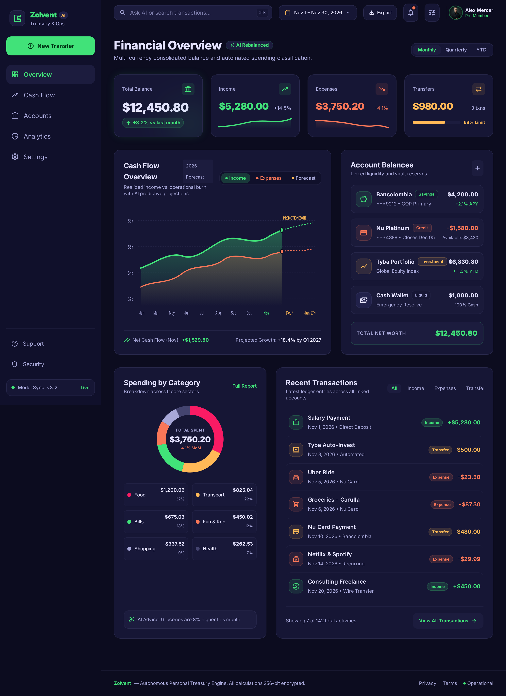
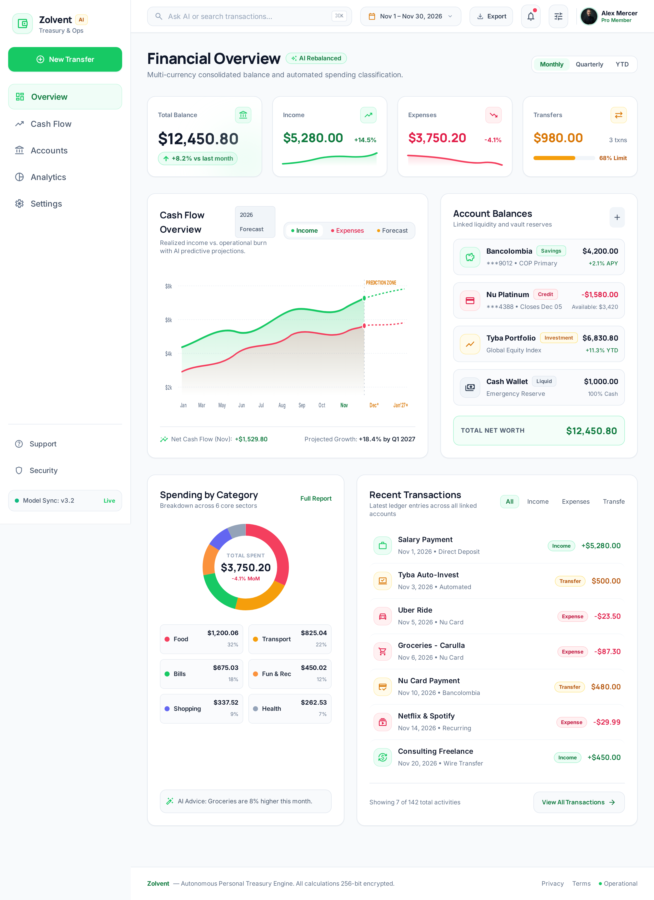
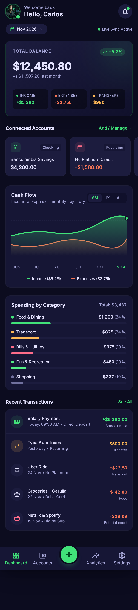

# Summary / Dashboard 2.0 Feature — Design & Implementation Plan

> **Tracking:** [GitHub Issue #40: Summary/Dashboard 2.0](https://github.com/carboleda/ai-money-tracker/issues/40)  
> **Stitch Project:** [Zolvent Dashboard 2.0](https://stitch.withgoogle.com) (Project ID: `11520392197038999460`)  
> **Status:** Plan Ready for Review — Implementation Pending Approval

---

## 1. Goal Description

Refactor and modernize the Zolvent home dashboard so it provides richer financial insights into user incomes, expenses, transfers, accounts liquidity, and future cash flow projections, adhering to the brand aesthetic and Hexagonal Clean Architecture.

### Core Deliverables from Issue #40:
1. **Date Range Filter**: Retain and integrate the existing date range picker with quick preset buttons (`currentMonth`, `lastMonth`, etc.).
2. **Balance for Each Active Account**: Clear status of liquid, credit, and investment accounts with quick actions (e.g. "Pay Credit Card").
3. **Overall Balance**: Aggregated real-time net liquidity across all active accounts with period-over-period trend badge (`+X.X% vs last month`).
4. **Recent Transactions**: Activity feed displaying the last 7 transactions with category iconography, merchant name, timestamp, colored transaction type pills, and signed amount.
5. **Cashflow Chart with Forecast**: 12-month historical area chart (Incomes vs Expenses) plus 3-month forward projection with a dashed line.
6. **Spending by Category**: High-contrast Donut breakdown (desktop) and progress bars (mobile) with category names, share percentages, and drill-down modal capability.
7. **Complete Theming**: Native light and dark mode support using CSS variables (`globals.css`) with zero hardcoded palette classes.
8. **Responsive Mobile-First UX**: Responsive grid on desktop, converting into an ergonomic mobile experience with horizontal scrolling account cards and bottom navigation.
9. **Charting Engine**: **Recharts (v3.10+)** replacing AG Charts for declarative SVG styling, gradient glows, CSS variable integration, and automatic responsiveness.

---

## 2. Visual Prototype Reference

| Desktop (Dark Theme) | Desktop (Light Theme) | Mobile (Dark Theme) |
| :---: | :---: | :---: |
|  |  |  |

---

## 3. Architecture & Data Flow

```mermaid
sequenceDiagram
    autonumber
    actor User as User (Client)
    participant Page as Dashboard (PageContent)
    participant RQ as TanStack Query (useQuery)
    participant Route as GET /api/summary?start=...&end=...
    participant Orchestrator as CalculateSummaryDashboardService
    participant TxFilter as FilterTransactionsService
    participant HistorySvc as GetSummaryHistoryService
    participant ForecastSvc as CalculateCashflowForecastService
    participant TrendsSvc as CalculateSummaryTrendsService
    participant AccountsSvc as GetAllAccountsService
    participant RecurringSvc as GetAllRecurringExpensesService

    User->>Page: Visits Dashboard or changes Date Range Filter
    Page->>RQ: Fetch summary data
    RQ->>Route: GET /api/summary?start=2026-11-01&end=2026-11-30
    Route->>Orchestrator: execute(startDate, endDate)
    
    par Period-Scoped Data
        Orchestrator->>TxFilter: Get transactions for [start, end]
        TxFilter-->>Orchestrator: currentTransactions[]
        Orchestrator->>TrendsSvc: execute(startDate, endDate, currentTransactions)
        TrendsSvc-->>Orchestrator: trends (MoM % changes)
    and Trailing 12-Month History & Forecast
        Orchestrator->>HistorySvc: execute() [12 trailing months]
        HistorySvc-->>Orchestrator: trailingHistory[]
        Orchestrator->>RecurringSvc: execute()
        RecurringSvc-->>Orchestrator: activeRecurringExpenses[]
        Orchestrator->>ForecastSvc: execute(trailingHistory, activeRecurringExpenses)
        ForecastSvc-->>Orchestrator: forecastMonths[]
    and Live Accounts Liquidity
        Orchestrator->>AccountsSvc: execute()
        AccountsSvc-->>Orchestrator: accountsBalance[]
    end

    Orchestrator-->>Route: SummaryDto (trends, cashflow, accounts, categories, recentTransactions)
    Route-->>RQ: 200 OK + JSON
    RQ-->>Page: Update Dashboard state
    Page-->>User: Render updated UI & Recharts animations
```



---

## 4. Backend Implementation Plan

### 4.1. Decoupling Period Metrics from 12-Month History
* **Current Problem**: `CalculateSummaryDashboardService` passes user-filtered transactions into `GetSummaryHistoryService`. If the user selects a 7-day range, the 12-month chart breaks because the current month only has 7 days of data.
* **Solution**:
  * `currentTransactions`: Filtered strictly by `[startDate, endDate]`. Drives `byCategory`, `byType`, and `recentTransactions`.
  * `cashflow`: Independent 12-month trailing calendar snapshot + 3-month forecast. It always displays a full year regardless of whether the user filters the top tiles by a single week or a month.

### 4.2. Cashflow Forecast Service (`CalculateCashflowForecastService`)
* **Location**: `src/app/api/domain/summary/service/calculate-cashflow-forecast.service.ts`
* **Algorithm**:
  1. **Historical Moving Average**: Take the last 3 to 6 months of `SummaryHistoryModel[]` to compute average variable monthly expenses and average monthly income.
  2. **Active Recurring Bills**: Inject `GetAllRecurringExpensesService` to extract recurring monthly bills (`frequency === MONTHLY` and non-disabled) scheduled for future months $M+1, M+2, M+3$.
  3. **Projection Model**:
     $$\text{Projected Expenses}(M+k) = \sum \text{RecurringBills}(M+k) + \text{RollingAverageVariableExpenses}$$
     $$\text{Projected Incomes}(M+k) = \text{RollingAverageRegularIncomes}$$
     $$\text{Projected NetFlow}(M+k) = \text{Projected Incomes} - \text{Projected Expenses}$$
  4. Flag all projection points with `isForecast: true`.

### 4.3. Period Trends Service (`CalculateSummaryTrendsService`)
* **Location**: `src/app/api/domain/summary/service/calculate-summary-trends.service.ts`
* **Algorithm**:
  1. Calculate duration: $D = \text{endDate} - \text{startDate}$.
  2. Define previous window: $[\text{startDate} - D - 1, \text{startDate} - 1]$.
  3. Query `FilterTransactionsService` for the prior period.
  4. Calculate percentage change for Balance, Incomes, and Expenses:
     $$\Delta\% = \frac{\text{current} - \text{previous}}{|\text{previous}|} \times 100$$
     (Returns `0` when `previous === 0` to prevent division by zero).

### 4.4. DTO & Model Updates

#### New DTOs:
```typescript
// src/app/api/domain/summary/model/cashflow-point.dto.ts
export interface CashflowPointDto {
  date: string;          // ISO timestamp or "YYYY-MM"
  monthLabel: string;    // "Jan", "Feb", etc.
  incomes: number;
  expenses: number;
  netFlow: number;
  isForecast?: boolean;
}

// src/app/api/domain/summary/model/summary-trends.dto.ts
export interface MetricTrendDto {
  current: number;
  previous: number;
  percentageChange: number; // e.g. +8.2, -4.5
}

export interface SummaryTrendsDto {
  balance: MetricTrendDto;
  incomes: MetricTrendDto;
  expenses: MetricTrendDto;
}
```

#### Updated `SummaryDto` (`src/app/api/domain/summary/model/summary.dto.ts`):
```typescript
export interface SummaryDto {
  accountsBalance: AccountModel[];
  totalBalance: number;
  trends: SummaryTrendsDto;
  cashflow: CashflowPointDto[];
  byCategory: CategorySummaryDto[];
  byType: TypeSummaryDto[];
  recentTransactions: TransactionOutput[];
  recurringVsVariable: RecurringVsVariableDto;
}
```

### 4.5. DI Container Registration
In `src/app/api/domain/summary/summary.module.ts`:
* Register `CalculateCashflowForecastService`.
* Register `CalculateSummaryTrendsService`.
* Update `CalculateSummaryDashboardService` constructor with new injected services.

---

## 5. Frontend Implementation Plan (Recharts v3)

### 5.1. Charting Engine Migration
* Install `recharts@^3.10.1` (has native React 19 peer dependency support).
* Remove `ag-charts-community` and `ag-charts-react`.
* Bind charts directly to Zolvent CSS variables (`var(--success)`, `var(--danger)`, `var(--warning)`, `var(--accent)`, `var(--surface)`).

### 5.2. Dashboard Grid Architecture (3 Rows)
Refactor `src/components/features/Summary/PageContent/index.tsx` into a responsive 12-column grid:

```
+---------------------------------------------------------------------------------------------------+
| Top Navigation: Logo | CustomDateRangePicker (Presets) | UserAvatar                               |
+---------------------------------------------------------------------------------------------------+
| Row 1: SummaryMetricsStrip (4 equal-width cards)                                                  |
| [ Overall Balance (+8.2%) ]  [ Incomes ($5,280) ]  [ Expenses ($3,750) ]  [ Transfers ($980) ]    |
+-----------------------------------------------------------------+---------------------------------+
| Row 2: (60% / 40% Grid)                                         |                                 |
| CashflowAreaChart (12-Mo Trailing + 3-Mo Forecast Line)         | ConnectedAccountsTile           |
| Area curves with SVG gradients + dashed forecast                | Balances & "Pay Credit" actions |
+-----------------------------------------------------------------+---------------------------------+
| Row 3: (40% / 60% Grid)                                         |                                 |
| CategoryDonutChart                                              | RecentTransactionsTile          |
| Donut ring with center spend total + category legend            | Last 7 rows with type chips     |
+---------------------------------------------------------------------------------------------------+
```

### 5.3. Component Specifications

#### 1. `SummaryMetricsStrip.tsx`
* 4 cards with `bg-surface border border-border rounded-2xl p-5`.
* Overall balance card includes emerald radial glow badge for `+X.X% vs last month`.
* Income, expense, and transfer cards have matching semantic colors (`text-success`, `text-danger`, `text-warning`).

#### 2. `CashflowAreaChart.tsx` (`src/components/charts/recharts/`)
* Recharts `<AreaChart>` wrapped in `<ResponsiveContainer width="100%" height={320}>`.
* `<defs>` contains:
  * `#incomeGlow`: Linear gradient of `var(--success)` fading from opacity 0.35 to 0.0.
  * `#expenseGlow`: Linear gradient of `var(--danger)` fading from opacity 0.25 to 0.0.
* `<Line>` for projected forecast with `stroke="var(--accent)" strokeDasharray="4 4"`.
* Custom HTML `<Tooltip>` using HeroUI tokens, displaying month, income, expense, and net variance.

#### 3. `ConnectedAccountsTile.tsx`
* High-density list (desktop) or horizontal scrollable swipe cards (mobile).
* Displays account icon, bank name, type badge (`Checking`, `Credit`, `Investment`), and current balance.
* Credit card accounts with negative balance feature a "Pay" action button.
* Footer shows total active liquidity.

#### 4. `CategoryDonutChart.tsx` (`src/components/charts/recharts/`)
* Recharts `<PieChart>` with `<Pie innerRadius={65} outerRadius={90} paddingAngle={4}>`.
* Center text displays total expenses in bold typography.
* Color legend with category emoji/icon and percentage of total spend.
* Clicking a slice opens the existing `ChartDetailsModal.tsx` showing category transaction details.

#### 5. `RecentTransactionsTile.tsx`
* Displays the last 7 transactions in mobile-friendly card rows.
* Category icon badge, merchant name, localized relative date.
* Colored type chip: `TransactionType.INCOME` $\rightarrow$ `status="success"`, `EXPENSE` $\rightarrow$ `status="danger"`, `TRANSFER` $\rightarrow$ `status="warning"`.
* Footer link to full transaction page (`/private/transactions`).

---

## 6. Implementation Checklist

- [ ] **Phase 1: Backend Domain Refactoring**
  - [ ] Implement `CalculateSummaryTrendsService` with prior-period delta calculations.
  - [ ] Implement `CalculateCashflowForecastService` with recurring expense projections.
  - [ ] Refactor `CalculateSummaryDashboardService` to isolate 12-month cashflow from custom date ranges.
  - [ ] Update `SummaryDto` and client `GetSummaryResponse` types.
  - [ ] Register new services in `SummaryModule.ts`.
  - [ ] Add unit tests (`.spec.ts`) for trend and forecast services.
- [ ] **Phase 2: Chart Engine Migration**
  - [ ] Install `recharts@^3.10.1` and uninstall `ag-charts-*`.
  - [ ] Build `CashflowAreaChart.tsx` with gradient fills and forecast line.
  - [ ] Build `CategoryDonutChart.tsx` with center metrics and drill-down trigger.
  - [ ] Build `FixedVsVariableBarChart.tsx`.
- [ ] **Phase 3: UI Dashboard Tiles & Layout**
  - [ ] Build `SummaryMetricsStrip.tsx` with trend badges.
  - [ ] Build `ConnectedAccountsTile.tsx` with desktop list & mobile carousel.
  - [ ] Build `RecentTransactionsTile.tsx` with 7-item activity feed.
  - [ ] Refactor `src/components/features/Summary/PageContent/index.tsx` into 3-row layout.
- [ ] **Phase 4: Theme, Mobile & Quality Audit**
  - [ ] Verify dark and light theme fidelity (zero hardcoded colors, 100% semantic CSS variables).
  - [ ] Test mobile viewport responsiveness and touch scrolling.
  - [ ] Run `npm run lint` and `npm test`.

