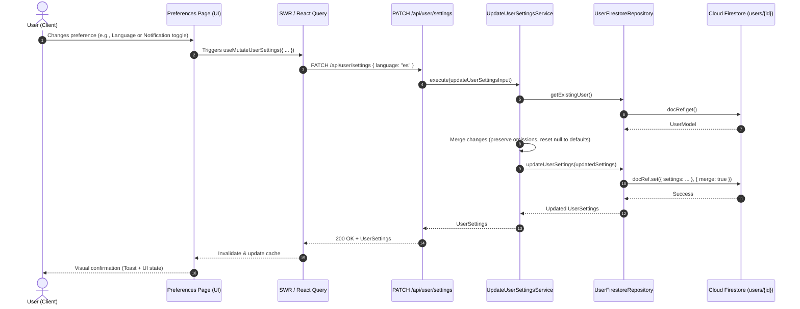

# User Preferences Feature — Design & Implementation Plan

## Goal Description

Enable Zolvent users to access and modify their account preferences to personalize their experience. The UI uses the friendly term **Preferences** while maintaining compatibility with the underlying **settings** data model in Firestore and domain logic.

The feature covers:

1. **Profile Information (Read-only)**: User picture, display name, and email from Firebase Auth context.
2. **General Preferences**:
   - Preferred language (English, Spanish) with instant UI switching and persistence.
   - Monthly report creation day (day of month 1–28/31, defaulting to day 2).
3. **Notifications**:
   - Push notifications master switch (handles browser permission + FCM token registration).
   - Daily due payment reminders format: Standalone (one per due payment) vs. Digest (single summary).
   - Early due payment reminder timing / days ahead.
   - New transaction notifications from Apple Wallet integration.
   - Apple Wallet Shortcut download card/button (with placeholder for user's URL).
4. **Adaptive UI Layout**:
   - **Mobile**: Single-column view with clickable drill-down rows; tapping grouped sections (like Notifications) transitions seamlessly to a sub-view with a back button without navigating away or changing URLs.
   - **Desktop**: Single-column layout with all preferences organized in clearly headed sections.
5. **Backend Endpoint**: `PATCH /api/user/settings` adhering to Hexagonal Architecture, merging partial updates and resetting `null` fields to defaults.

---

## Confirmed User Decisions

- **Early Due Payment Reminder Format**: **Option A** — Days ahead selector (Same day, 1 day before, 2 days before, 3 days before, 5 days before, 7 days before) directly connected to reminder scheduling logic.
- **Apple Wallet Shortcut Link**: Configured with a placeholder in `siteConfig.links.appleShortcut = "#"` and environment config until final URL is provided.
- **Navigation Access**: Dual entry points — accessible via the main sidebar navigation under `settings` group and by clicking the `UserAvatar` in the sidebar.
- **Stitch Project**: Created screens in Stitch project `14259266719613027943`:
  - `User Preferences - Mobile` (Screen ID: `535bd6a7d92c414e8a0f720cbc951ccc`)
  - `Notifications - Zolvent Preferences` (Screen ID: `cc36d67a85194b829682b8d10ab92f8d`)
  - `User Preferences - Desktop` (Screen ID: `a78449f7559e4ca0bd3a2721c1156e94`)

---

## Architecture & Data Flow



---

## UI/UX Design & Stitch Mockups (Project `14259266719613027943`)

```carousel

<!-- slide -->

<!-- slide -->

```

### 1. Navigation & Access

- Route: `/private/preferences`
- Menu item added to `siteConfig.pages` with icon (`HiAdjustmentsHorizontal`) and label key `preferences` under the `settings` group.
- Clicking the `UserAvatar` in the sidebar also links to `/private/preferences`.
- Top navbar displays title **Preferences** and subtitle **Personalize your Zolvent experience**.

### 2. Mobile Layout (Interactive Drill-Down)

- Single-column list with iOS/PWA-style settings rows:
  - **Profile Information Card (Read-only)**:
    - User avatar, full name, and email with a discreet "Managed by Google" badge.
  - **General Section**:
    - **Language**: Row showing selected language with quick popup or inline select ("English" / "Español").
    - **Monthly Report Day**: Row with dropdown/stepper showing "Day X of every month".
  - **Group Row — Notifications**:
    - Tap target row: Bell icon + "Notifications" + subtitle preview ("Push On · Digest · Apple Wallet") + trailing chevron (`HiChevronRight`).
    - On tap: Smoothly transitions into the **Notifications Sub-page** inside the same screen (no browser route change).
    - Sub-page header: `< Back` button returning to the main preferences list.
    - Inside Notifications sub-page:
      - Push Notifications toggle (`Switch`)
      - Daily Due Reminders Type (`RadioGroup`: Standalone vs Digest)
      - Early Due Reminder Timing (`CustomDropdown` or `Select`: 1 day before, 2 days before, etc.)
      - Apple Wallet Integration toggle (`Switch`)
      - Shortcut Download Card with "Download Shortcut" button and icon

### 3. Desktop Layout (Comprehensive Grouped Sections)

- Single-column layout on standard viewport:
  - **Profile Information Section**: Elevated card displaying user avatar, display name, email, and read-only indicator.
  - **General Preferences Section**: Heading "General" with Language selector and Monthly Report Day selector.
  - **Notifications Section**: Heading "Notifications" with:
    - Push notifications switch
    - Daily due payment reminders format radio group / segmented buttons
    - Early due payment reminder days dropdown
    - Apple Wallet integration switch + Shortcut download action card

### 4. Visual Theming & Accessibility

- Strict adherence to AGENTS.md theme tokens (`bg-surface`, `bg-background`, `text-foreground`, `text-muted`, `border-border`, `bg-accent`, `text-accent`).
- No hardcoded palette colors (`zinc-*`, `gray-*`) and no `dark:` prefix variants.
- All labels and descriptions defined in translation files (`en/preferences.json`, `es/preferences.json`, `en/common.json`, `es/common.json`).
- Mobile touch targets adhere to minimum 44×44px.

---

## Proposed Changes

### Data Model & Shared Interfaces

#### [MODIFY] [user.model.ts](file:///Users/carboleda/Documents/SideProjects/Zolvent/ai-money-tracker/src/app/api/domain/user/model/user.model.ts)

Extend `UserSettings` to include all preferences:

```typescript
export enum EmailStrategy {
  DIGEST = "digest",
  STANDALONE = "standalone",
}

export type UserSettings = {
  // Notifications
  pushNotificationsEnabled?: boolean;
  emailStrategy?: EmailStrategy;
  earlyReminderDaysAhead?: number;
  paymentNotificationsEnabled?: boolean;

  // General & Reports
  language?: "en" | "es";
  monthlyReportDay?: number;
};
```

#### [MODIFY] [user.ts](file:///Users/carboleda/Documents/SideProjects/Zolvent/ai-money-tracker/src/interfaces/user.ts)

Add `UserSettings` to client-facing user interfaces:

```typescript
export interface UserSettings {
  pushNotificationsEnabled?: boolean;
  emailStrategy?: "digest" | "standalone";
  earlyReminderDaysAhead?: number;
  paymentNotificationsEnabled?: boolean;
  language?: "en" | "es";
  monthlyReportDay?: number;
}

export interface UserEntity {
  devices: UserDevice[];
  settings?: UserSettings;
}

export interface User extends UserEntity {
  id?: string;
  email?: string;
}
```

---

### Backend: Hexagonal Architecture (Domain & Drivers)

#### [NEW] [update-user-settings.port.ts](file:///Users/carboleda/Documents/SideProjects/Zolvent/ai-money-tracker/src/app/api/domain/user/ports/inbound/update-user-settings.port.ts)

Zod validation schema and TypeScript input interface:

```typescript
import { z } from "zod";
import { EmailStrategy } from "../../model/user.model";

export const UpdateUserSettingsSchema = z.object({
  pushNotificationsEnabled: z.boolean().nullable().optional(),
  emailStrategy: z.nativeEnum(EmailStrategy).nullable().optional(),
  earlyReminderDaysAhead: z.number().int().min(0).max(30).nullable().optional(),
  paymentNotificationsEnabled: z.boolean().nullable().optional(),
  language: z.enum(["en", "es"]).nullable().optional(),
  monthlyReportDay: z.number().int().min(1).max(31).nullable().optional(),
});

export type UpdateUserSettingsInput = z.infer<typeof UpdateUserSettingsSchema>;
```

#### [NEW] [update-user-settings.service.ts](file:///Users/carboleda/Documents/SideProjects/Zolvent/ai-money-tracker/src/app/api/domain/user/service/update-user-settings.service.ts)

Implements use-case logic: merges provided fields, unsets keys when set to `null` to restore defaults, and persists via `UserRepository`:

```typescript
import "reflect-metadata";
import {
  Injectable,
  InjectRepository,
} from "@/app/api/decorators/tsyringe.decorator";
import { Service } from "@/app/api/domain/shared/ports/service.interface";
import type { UserRepository } from "../repository/user.repository";
import { UserModel, UserSettings } from "../model/user.model";
import { UpdateUserSettingsInput } from "../ports/inbound/update-user-settings.port";

@Injectable()
export class UpdateUserSettingsService implements Service<
  UpdateUserSettingsInput,
  UserSettings
> {
  constructor(
    @InjectRepository(UserModel)
    private readonly userRepository: UserRepository,
  ) {}

  async execute(input: UpdateUserSettingsInput): Promise<UserSettings> {
    const existingUser = await this.userRepository.getExistingUser();
    const currentSettings = { ...(existingUser?.settings ?? {}) };

    for (const [key, value] of Object.entries(input)) {
      if (value === undefined) continue;
      if (value === null) {
        delete (currentSettings as any)[key];
      } else {
        (currentSettings as any)[key] = value;
      }
    }

    const updatedUser = new UserModel({
      id: existingUser?.id ?? "",
      email: existingUser?.email ?? "",
      devices: existingUser?.devices ?? [],
      settings: currentSettings,
    });

    await this.userRepository.updateOrCreateUser(updatedUser);
    return currentSettings;
  }
}
```

#### [MODIFY] [user.module.ts](file:///Users/carboleda/Documents/SideProjects/Zolvent/ai-money-tracker/src/app/api/domain/user/user.module.ts)

Register `UpdateUserSettingsService` in the dependency injection container.

#### [NEW] [route.ts](<file:///Users/carboleda/Documents/SideProjects/Zolvent/ai-money-tracker/src/app/api/(routes)/user/settings/route.ts>)

Next.js route handler for `PATCH /api/user/settings` and `GET /api/user/settings`:

```typescript
import "reflect-metadata";
import { NextRequest, NextResponse } from "next/server";
import { api } from "@/app/api";
import { withUserContext } from "@/app/api/context/initialize-context";
import { UpdateUserSettingsService } from "@/app/api/domain/user/service/update-user-settings.service";
import { GetUserService } from "@/app/api/domain/user/service/get-user.service";
import { UpdateUserSettingsSchema } from "@/app/api/domain/user/ports/inbound/update-user-settings.port";
import { DomainError } from "@/app/api/domain/shared/errors/domain.error";

export async function GET(req: NextRequest) {
  return withUserContext(req, async () => {
    const service = api.resolve(GetUserService);
    const user = await service.execute();
    return NextResponse.json(user?.settings ?? {});
  });
}

export async function PATCH(req: NextRequest) {
  return withUserContext(req, async () => {
    try {
      const body = await req.json();
      const validatedInput = UpdateUserSettingsSchema.parse(body);

      const service = api.resolve(UpdateUserSettingsService);
      const settings = await service.execute(validatedInput);

      return NextResponse.json(settings, { status: 200 });
    } catch (error) {
      if (error instanceof DomainError) {
        return NextResponse.json(
          { message: error.message },
          { status: error.statusCode ?? 400 },
        );
      }
      return NextResponse.json(
        { message: (error as Error).message },
        { status: 400 },
      );
    }
  });
}
```

#### [MODIFY] [pending-transaction-notification.service.ts](file:///Users/carboleda/Documents/SideProjects/Zolvent/ai-money-tracker/src/app/api/domain/notification/service/pending-transaction-notification.service.ts)

Respect `user.settings.pushNotificationsEnabled` and `user.settings.earlyReminderDaysAhead`:

```typescript
// Skip if push notifications disabled
if (user.settings?.pushNotificationsEnabled === false) {
  return { success: true, processedTransactions: 0 };
}

// Use user setting or fall back to env default
const daysAhead =
  user.settings?.earlyReminderDaysAhead ?? Env.EARLY_REMINDER_DAYS_AHEAD;
earlyReminderDate.setDate(now.getDate() + daysAhead);
```

#### [MODIFY] [create-monthly-summary.service.ts](file:///Users/carboleda/Documents/SideProjects/Zolvent/ai-money-tracker/src/app/api/domain/summary/service/create-monthly-summary.service.ts)

Respect `user.settings.monthlyReportDay`:

```typescript
const user = await this.getUserService.execute();
const scheduledDay =
  user?.settings?.monthlyReportDay ?? Env.RUN_ON_DAY_OF_MONTH;
if (now.getDate() !== scheduledDay) {
  return;
}
```

---

### Frontend: UI Components, Hooks, & Localization

#### [NEW] [useMutateUserSettings.ts](file:///Users/carboleda/Documents/SideProjects/Zolvent/ai-money-tracker/src/hooks/useMutateUserSettings.ts)

Custom React Query hook to send `PATCH /api/user/settings` and invalidate cache:

```typescript
import { useMutation, useQueryClient } from "@tanstack/react-query";
import { sendRequest, invalidateResource } from "@/config/request";
import { UserSettings } from "@/interfaces/user";
import { useOfflineWriteGuard } from "@/hooks/useOnlineStatus";

const KEY = "/api/user/settings";
const USER_KEY = "/api/user";

export const useMutateUserSettings = () => {
  const queryClient = useQueryClient();
  const guardOnline = useOfflineWriteGuard();

  const { mutateAsync, isPending } = useMutation({
    mutationFn: (settings: Partial<UserSettings | Record<string, unknown>>) =>
      sendRequest(KEY, {
        method: "PATCH",
        body: JSON.stringify(settings),
      }),
    onSuccess: () => {
      invalidateResource(queryClient, KEY);
      invalidateResource(queryClient, USER_KEY);
    },
  });

  const updateSettings = async (
    settings: Partial<UserSettings | Record<string, unknown>>,
  ) => {
    if (!guardOnline()) throw new Error("Offline");
    const res = await mutateAsync(settings);
    if (!res.ok) throw new Error(res.statusText);
    return res.json();
  };

  return { updateSettings, isPending };
};
```

#### [NEW] Components in `src/components/features/Preferences/`:

- `ProfileSection.tsx`: Read-only user profile (avatar, name, email, auth provider note).
- `GeneralPreferencesSection.tsx`: Language picker with immediate i18n update + Monthly report day selector.
- `NotificationsSection.tsx`: Push toggle with browser permission integration, reminder format radio group, early reminder dropdown, Apple Wallet switch, and Shortcut download card.
- `PreferencesMobileView.tsx`: Single-column drill-down layout with transitions between main list and the Notifications sub-view with Back button.
- `PreferencesDesktopView.tsx`: Single-column layout displaying all sections with clear headings.
- `PageContent/index.tsx`: Main page content coordinating mobile vs. desktop views via `useIsMobile()`.

#### [NEW] [page.tsx](<file:///Users/carboleda/Documents/SideProjects/Zolvent/ai-money-tracker/src/app/(ui)/private/preferences/page.tsx>)

Next.js page route hosting `<PageContent />`.

#### [MODIFY] [site.ts](file:///Users/carboleda/Documents/SideProjects/Zolvent/ai-money-tracker/src/config/site.ts)

Add Preferences navigation entry to `pages` array under the settings group.

#### [MODIFY] [SidebarMenuItems.tsx](file:///Users/carboleda/Documents/SideProjects/Zolvent/ai-money-tracker/src/components/shared/Sidebar/SidebarMenuItems.tsx)

Make `UserAvatar` item navigate to `/private/preferences` on click.

#### [MODIFY] [config.ts](file:///Users/carboleda/Documents/SideProjects/Zolvent/ai-money-tracker/src/i18n/config.ts) & [namespace.ts](file:///Users/carboleda/Documents/SideProjects/Zolvent/ai-money-tracker/src/i18n/namespace.ts)

Add `"es"` to supported `languages = ["en", "es"]` and register `LocaleNamespace.Preferences = "preferences"`.

#### [NEW] [preferences.json (en)](file:///Users/carboleda/Documents/SideProjects/Zolvent/ai-money-tracker/src/i18n/locales/en/preferences.json) & [preferences.json (es)](file:///Users/carboleda/Documents/SideProjects/Zolvent/ai-money-tracker/src/i18n/locales/es/preferences.json)

Full localization dictionaries for all preference sections, labels, helpers, and alerts.

---

## Verification Plan

### Automated Tests

1. **Domain Unit Tests**:
   - `src/app/api/domain/user/service/__tests__/update-user-settings.service.spec.ts`:
     - Test partial update preservation.
     - Test unsetting to default with `null` values.
     - Test invalid payload rejection via Zod schema.
   - Run command:
     ```bash
     npx jest src/app/api/domain/user/service/__tests__/update-user-settings.service.spec.ts
     ```
2. **Cronjob & Notification Services Unit Tests**:
   - Verify `PendingTransactionNotificationService` respects `pushNotificationsEnabled` and custom `earlyReminderDaysAhead`.
   - Verify `CreateMonthlySummaryService` respects `monthlyReportDay`.
   - Run command:
     ```bash
     npx jest src/app/api/domain/notification/service/__tests__/pending-transaction-notification.service.spec.ts
     npx jest src/app/api/domain/summary/service/__tests__/create-monthly-summary.service.spec.ts
     ```
3. **Full Test Suite & Build Verification**:
   ```bash
   npm test
   npm run lint
   ```

### Manual Verification

1. **Desktop Flow**:
   - Open `/private/preferences` on desktop viewport.
   - Confirm Profile Information shows correct Google user avatar, name, and email.
   - Switch language from English to Spanish: verify immediate UI translation and persistence across reloads.
   - Change monthly report day: verify update saves and toast confirmation appears.
   - Toggle Apple Wallet notification and click the Shortcut download button.
2. **Mobile Flow**:
   - Switch viewport to mobile (≤ 700px).
   - Verify clean single-column list with clickable items.
   - Tap "Notifications": verify smooth in-page transition to the Notifications sub-view with a `< Back` button.
   - Modify notification settings inside the sub-view.
   - Tap `< Back`: verify return to main preferences list with updated summary badges.
3. **API Contract Verification**:
   - Send `PATCH /api/user/settings` with partial keys: verify untouched keys remain unchanged.
   - Send `PATCH /api/user/settings` with a key set to `null`: verify that setting is unset in Firestore.
